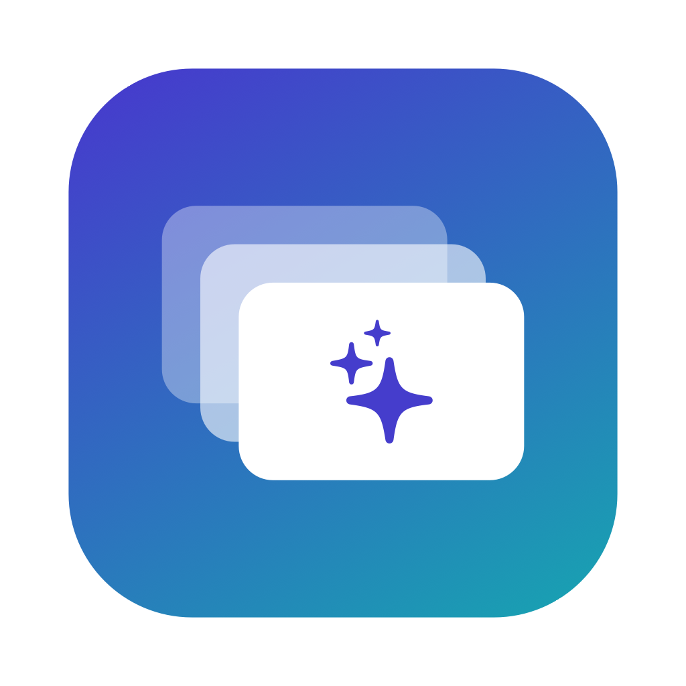
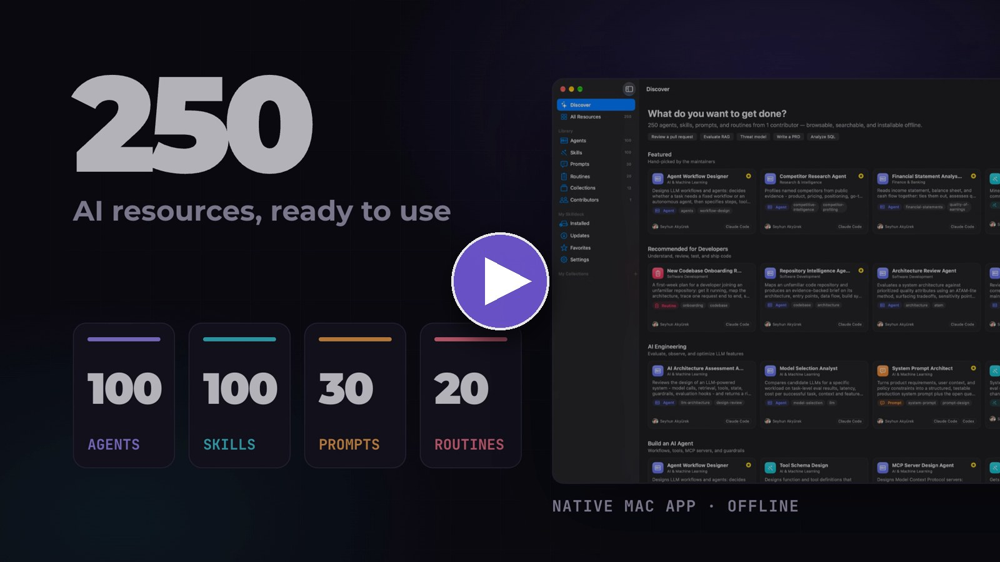
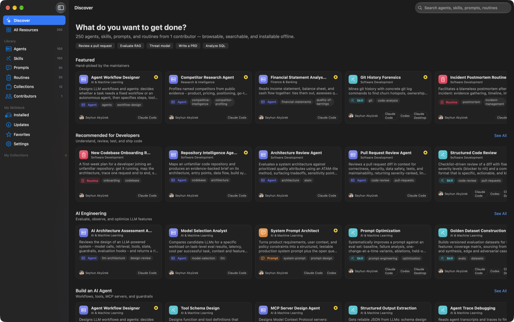
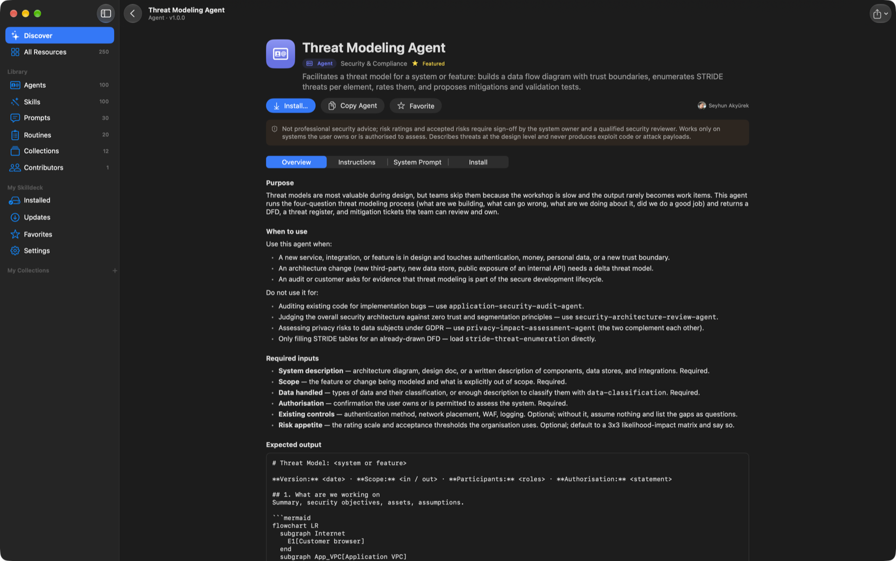
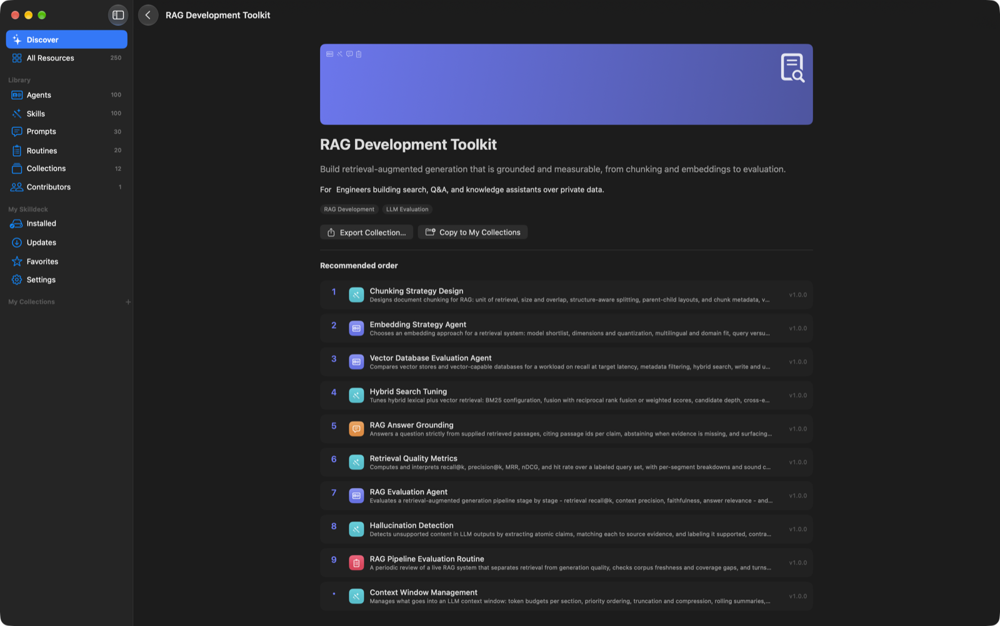

<p align="center">
  
</p>

<h1 align="center">Skilldeck</h1>

<p align="center">
  <strong>An open, local-first library of AI agents, skills, prompts, and routines, with a native macOS app to browse, install, and export them.</strong>
</p>

<p align="center">
  <a href="https://github.com/seyhunak/skilldeck/actions/workflows/validate-submission.yml"></a>
  <a href="https://github.com/seyhunak/skilldeck/actions/workflows/build-catalog.yml"></a>
  <a href="https://github.com/seyhunak/skilldeck/actions/workflows/macos-app.yml"></a>
  <a href="https://github.com/seyhunak/skilldeck/releases"></a>
  <br>
  
  
  
  
  <a href="LICENSE"></a>
  <a href="docs/CONTRIBUTOR_GUIDE.md"></a>
  <a href="https://claude.com/claude-code"></a>
</p>

<p align="center">
  <a href="#-contribute"><b>🤝 Contribute a resource</b></a> ·
  <a href="docs/SUBMISSION_GUIDE.md"><b>📬 Submission guide</b></a> ·
  <a href="templates/"><b>🧩 Templates</b></a> ·
  <a href="https://github.com/seyhunak/skilldeck/blob/main/docs/assets/skilldeck-explainer.mp4">🎬 Watch the explainer</a> ·
  <a href="#install-the-app">💻 Install the app</a> ·
  <a href="docs/ARCHITECTURE.md">🏗️ Architecture</a>
</p>

### 🎬 Skilldeck in 16 seconds

<p align="center">
  <a href="https://github.com/seyhunak/skilldeck/blob/main/docs/assets/skilldeck-explainer.mp4" title="Watch the Skilldeck explainer (16s, with sound)">
    
  </a>
  <br>
  <sub>▶ <a href="https://github.com/seyhunak/skilldeck/blob/main/docs/assets/skilldeck-explainer.mp4"><b>Watch the explainer</b></a> (16s, with voiceover) · made with <a href="https://hyperframes.heygen.com">HyperFrames</a> and ElevenLabs. Source: <a href="video/explainer/"><code>video/explainer/</code></a></sub>
</p>

<p align="center">
  
</p>

> [!TIP]
> **Got a prompt, skill, or agent you use every day? Share it.** Copy a [template](templates/), open a pull request, and once it's merged and the release is approved it reaches every Skilldeck app automatically. It even works entirely in the browser, with no tools to install. **[Start here →](#-contribute)**

---

Skilldeck is two things that live in one repository:

1. **A community content platform.** Agents, skills, prompts, and routines are plain Markdown + YAML packages under `resources/`. Every pull request is validated (schema, structure, safety, duplicate detection, compatibility claims). Every merge to `main` builds a versioned, checksummed catalog, which is published as a GitHub Release once a maintainer approves it.
2. **A native macOS app.** Skilldeck ships with the whole catalog bundled, so it works fully offline from first launch. It lets you discover, search, and read resources, then install them into **Claude Code**, **OpenAI Codex**, **Claude Desktop**, the **Agent Skills** format, or any folder you choose, with a preview of every file it will write.

## What's in the catalog

| Type | Count | What it is | Installs as |
|---|---:|---|---|
| **Agents** | 100 | Complete task-oriented specialists with a system prompt, procedure, output format, and quality bar | Claude Code subagents (`~/.claude/agents/`) |
| **Skills** | 100 | Reusable capabilities in the open [Agent Skills](https://agentskills.io) `SKILL.md` format | Claude Code / Codex skills, Claude Desktop skill zips |
| **Prompts** | 30 | Copy-ready prompts with documented `{{PLACEHOLDERS}}` | Claude Code commands, Codex custom prompts |
| **Routines** | 20 | Repeatable human-guided workflows with steps and checklists | Claude Code commands |

That's 250 resources across 10 domains: software development, AI & machine learning, product & design, data & analytics, marketing & growth, research & intelligence, finance & banking, security & compliance, operations & productivity, and strategy & leadership. They're grouped into 12 curated collections such as *RAG Development Toolkit* and *Complete Software Development Toolkit*.

<p align="center">
  
  
</p>

## App features

- **Discover**: featured resources, shelves by goal, most-referenced resources, and curated collections.
- **Search** across names, descriptions, tags, use cases, and content, with suggestions, filters (type, domain, use case, platform, compatibility level, author, installed state, featured), sorting, and grid/list views. Press <kbd>⌘K</kbd> to search.
- **Detail pages** rendered from the package Markdown: purpose, inputs, procedure, outputs, examples, limitations, safety notes, related resources, and a prompt panel that fills in placeholders before you copy.
- **Install** with a dry-run plan that shows every destination file. Existing files are never overwritten silently: you choose cancel, or back up and replace. You can install for your user, a project folder, or a custom directory, and every file is hash-checked after writing.
- **Installed** view that detects local edits, updates resources when the catalog has a newer version, and uninstalls to the Trash. Files you've modified are kept.
- **Export** a single package as a folder or zip, a Claude Desktop skill zip, an `AGENTS.md` section for Codex, or the complete catalog.
- **Favorites, recents, and personal collections**, stored locally in JSON.
- **Contributors**: profile pages with GitHub avatar, bio, and featured work, cached for 24h and resilient to rate limits.
- **Catalog updates**: checks for new community resources at launch and periodically (every 6 hours by default) against the rolling `catalog-latest` release, installs them automatically (optional), highlights them under *New in the Catalog*, verifies SHA-256 for the bundle and every package, shows a diff of added, updated, and removed resources before applying, and lets you roll back to the previous version or the bundled catalog in one click.
- **Deep links** such as `skilldeck://resource/threat-modeling-agent`, `skilldeck://collection/rag-development-toolkit`, and `skilldeck://search/postmortem`.

## Install the app

**From source** (macOS 15+, Xcode 16+):

```bash
brew install xcodegen
```

```bash
git clone https://github.com/seyhunak/skilldeck.git && cd skilldeck/app && xcodegen generate
```

```bash
xcodebuild -project Skilldeck.xcodeproj -scheme Skilldeck -configuration Release -derivedDataPath build/DerivedData build
```

```bash
open build/DerivedData/Build/Products/Release/Skilldeck.app
```

**Prebuilt:** every run of the [macOS app workflow](https://github.com/seyhunak/skilldeck/actions/workflows/macos-app.yml) uploads a `Skilldeck-app` zip. Builds are ad-hoc signed and not notarized, so on first launch right-click the app and choose **Open**.

**Without the app:** every resource is plain files. Copy a skill folder into `~/.claude/skills/`, or download `packages/<id>.zip` from the [latest catalog release](https://github.com/seyhunak/skilldeck/releases).

## 🤝 Contribute

Skilldeck grows through its community. **Anyone with a GitHub account can add an agent, skill, prompt, or routine.** Every contributor gets a profile page in the app with their GitHub avatar and everything they've shared.

### How a submission becomes part of the app

```text
  1. You             2. CI (automatic)          3. Maintainer        4. Release (automatic)        5. Every Skilldeck app
 ─────────────      ──────────────────────      ──────────────       ───────────────────────       ───────────────────────
  copy a template ▶  Validate submission    ▶   review & merge  ▶   build catalog-v1.N.0     ▶    checks at launch + every
  fill it in         schema · structure ·       into main            maintainer approves          6h, verifies SHA-256,
  open a PR          safety · duplicates ·                           → latest.json                shows "New in the Catalog"
                     compatibility
```

`main` is protected, so a PR can only merge once **Validate catalog changes** passes. The catalog the app reads is published only after the repository owner or an authorized maintainer approves the release.

### Quick start

**In the browser** (nothing to install):

1. **Fork** this repo.
2. Open the [template](templates/) for your type and copy its two files.
3. **Add file → Create new file** at `resources/<domain>/<use-case>/<your-id>/manifest.yaml` (typing `/` creates the folders), paste, and fill in. Then add the entrypoint file next to it.
4. **Open a pull request.** The check's summary lists anything that needs fixing.

**On your machine:**

```bash
gh repo fork seyhunak/skilldeck --clone && cd skilldeck && python3 -m pip install -r requirements.txt
```

```bash
cp -R templates/skill resources/software-development/code-review/my-skill-id
```

```bash
python3 scripts/validate_catalog.py --only my-skill-id
```

```bash
git checkout -b add-my-skill-id && git add resources && git commit -m "Add my-skill-id skill" && gh pr create --fill
```

### Templates

| Type | Template | Entrypoint | Required `##` sections | Min. words |
|---|---|---|---|---:|
| **Agent**: a specialist for a whole task (ships as a Claude Code subagent) | [`templates/agent/`](templates/agent/) | `agent.md` | Purpose · When to use · Required inputs · Operating procedure · Expected output · Supporting skills · Example prompts · Error handling · Limitations · Safety boundaries | 650 |
| **Skill**: a focused capability an agent loads when relevant ([Agent Skills](https://agentskills.io)) | [`templates/skill/`](templates/skill/) | `SKILL.md` | When to use · Inputs · Procedure · Expected output · Constraints | 400 |
| **Prompt**: one copy-ready prompt with `{{VARIABLES}}` | [`templates/prompt/`](templates/prompt/) | `prompt.md` | Intended task · Required context · Prompt · Variables · Output format · Example usage · Customization | 300 |
| **Routine**: a repeatable human-guided workflow | [`templates/routine/`](templates/routine/) | `routine.md` | Objective · Trigger · Prerequisites · Inputs · Steps · Decision points · Expected output · Validation checklist · Human approval | 400 |
| **Contributor profile** (optional) | [`templates/contributor/`](templates/contributor/) | `contributors/<login>/profile.yaml` | — | — |

Domains and use cases come from [`catalog/domains.yaml`](catalog/domains.yaml). The folder path must be `resources/<domain>/<first use case>/<id>/`.

<details>
<summary><b>📄 Example: a complete skill package</b> (click to expand)</summary>

`resources/software-development/code-review/sql-migration-review/manifest.yaml`

```yaml
schema_version: "1.1"
id: sql-migration-review               # same as the folder name
name: SQL Migration Review
type: skill
description: Reviews a SQL schema migration for locking, data loss, and rollback risk before it runs in production.
purpose: >
  Catch the migrations that take a table lock for minutes or silently drop data,
  while they are still a pull request.
version: 1.0.0
author:
  name: Your Name
  github: your-github-login            # becomes your profile page + avatar
license: MIT
domain: software-development
use_cases: [code-review]
tags: [sql, migrations, databases]
created: "2026-11-09"
updated: "2026-11-09"
content:
  entrypoint: SKILL.md
  files: []                            # list any extra files, e.g. references/checklist.md
compatibility:                         # keep within catalog/compatibility.yaml
  - {platform: claude-code, level: native_install, resource_types: [skill]}
  - {platform: codex, level: native_install, resource_types: [skill]}
  - {platform: claude-desktop, level: native_import, resource_types: [skill]}
  - {platform: agent-skills, level: file_export, resource_types: [skill]}
  - {platform: generic, level: generic_export, resource_types: [skill]}
dependencies: []
related: []
safety:
  contains_scripts: false
  network_access: false
  handles_sensitive_data: false
  notes: Reviews migration text only; never connects to a database.
status: submitted                      # leave as-is; merge + approved release publishes it
tested: false
tested_with: []
changelog: ["1.0.0: Initial submission."]
```

`resources/software-development/code-review/sql-migration-review/SKILL.md`

```markdown
---
name: sql-migration-review
description: Review a SQL schema migration for lock duration, data loss, and rollback safety. Use when a pull request adds or changes a migration file.
---

# SQL Migration Review

## When to use
A PR adds a migration (ALTER/CREATE/DROP, backfills). Not for query performance tuning.

## Inputs
- The migration file(s) and the target database engine and version.
- Optional: approximate row counts of the affected tables.

## Procedure
1. Classify each statement: additive, destructive, or rewriting.
2. Flag statements that take an ACCESS EXCLUSIVE lock on large tables ...
3. ... (concrete, checkable steps with thresholds)

## Expected output
A table: statement · risk (blocker/major/minor) · why · safer alternative.

## Constraints
Never suggest running the migration. State the assumed engine version.
```

Real skills are longer (400+ words) with worked examples. Browse [`resources/`](resources/) for 250 of them.
</details>

### What makes a great submission

- ✅ **Concrete**: real steps, commands, criteria, and thresholds, not "follow best practices"
- ✅ **A defined output** someone can act on, with an example
- ✅ **Honest** limitations and safety boundaries (finance, legal, and security content needs the disclaimer)
- ✅ **Original**: not a near-copy of an existing resource (the validator flags ≥ 45% overlap)
- ❌ No secrets, scripts, binaries, or symlinks. Only `.md .txt .yaml .yml .json .csv` files.

📚 **Guides:** [Submission guide](docs/SUBMISSION_GUIDE.md) (step by step, plus common validation errors) · [Contributor guide](docs/CONTRIBUTOR_GUIDE.md) · [Package format](docs/FORMAT.md) · [Compatibility](docs/COMPATIBILITY.md) · [Review policy](docs/REVIEW_POLICY.md)

💡 Not ready to write one? [Request a resource](https://github.com/seyhunak/skilldeck/issues/new?template=resource_request.yml) or [report a problem with one](https://github.com/seyhunak/skilldeck/issues/new?template=resource_problem.yml).

**Improving the app or tooling?** See [Development & testing](docs/DEVELOPMENT.md). Run `cd app && swift test` and `python3 -m unittest discover -s tests` before opening a PR.

## Repository layout

```text
resources/<domain>/<use-case>/<id>/   250 packages: manifest.yaml + agent.md | SKILL.md | prompt.md | routine.md
catalog/                              domains, collections, compatibility registry, launch requirements
contributors/<login>/profile.yaml     contributor profiles
schemas/                              JSON Schemas for manifests, profiles, collections
templates/                            starting points for each resource type
scripts/                              validate, build, launch gate, quality report (Python, no network)
tests/                                tooling tests (unittest)
app/                                  macOS app: SkilldeckCore Swift package + SwiftUI app (XcodeGen)
.github/workflows/                    PR validation, catalog build, catalog release, macOS app CI
docs/                                 architecture, format, compatibility, security, release process
```

## Documentation

- [Architecture](docs/ARCHITECTURE.md): how the catalog pipeline and the app fit together
- [Package format](docs/FORMAT.md): manifest v1.1 and the entrypoint format for each type
- [Compatibility](docs/COMPATIBILITY.md): where each type installs, per platform
- [Submission guide](docs/SUBMISSION_GUIDE.md) · [Contributor guide](docs/CONTRIBUTOR_GUIDE.md) · [Review policy](docs/REVIEW_POLICY.md)
- [Security model](docs/SECURITY.md) · [Release process](docs/RELEASE_PROCESS.md) · [Development & testing](docs/DEVELOPMENT.md)
- [Quality report](reports/quality-report.md): heuristic scores for every resource

## Security

Catalog content is treated as untrusted data. The app never executes anything from a package. Packages that declare scripts are refused, and install paths are validated against traversal and symlinks. Every file is checked against the catalog's SHA-256 before and after writing, and any resource whose hash doesn't match is quarantined. Please report vulnerabilities privately through [GitHub Security Advisories](https://github.com/seyhunak/skilldeck/security/advisories/new). See [SECURITY.md](docs/SECURITY.md).

## Proudly powered by Claude

Skilldeck was designed and built with [Claude](https://claude.com) using [Claude Code](https://claude.com/claude-code): the macOS app, the validation and release tooling, and the launch catalog of 250 resources. Every resource was written for real day-to-day use, then held to the same validator and review bar as community submissions.

## License

[MIT](LICENSE) © Seyhun Akyürek and contributors. Each resource declares its own license in `manifest.yaml`. All launch resources are MIT.
